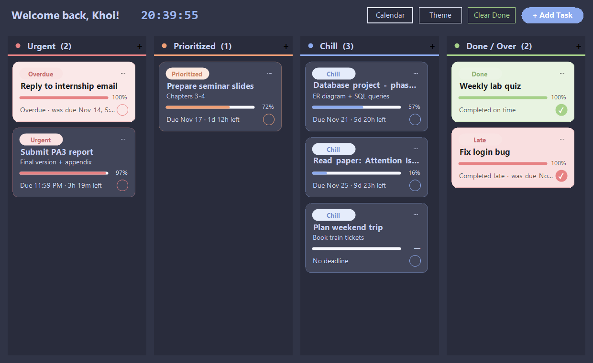
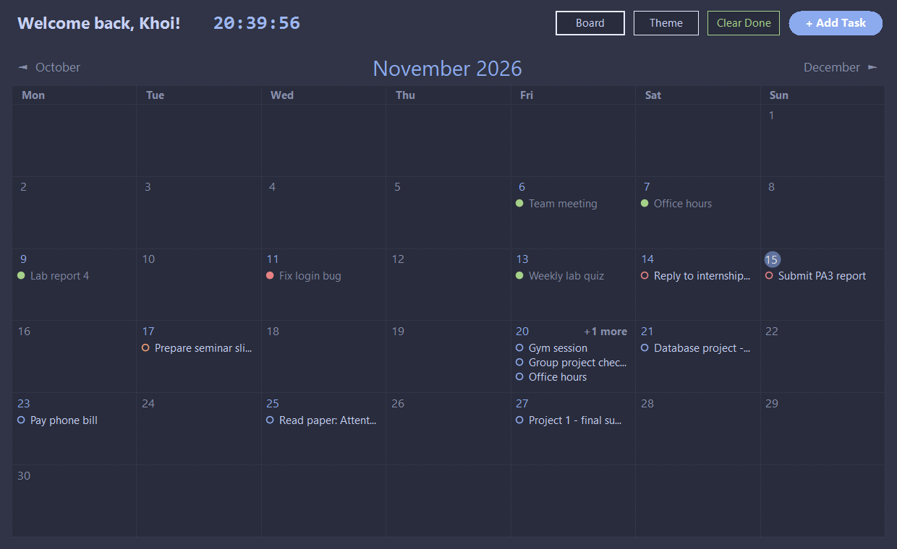
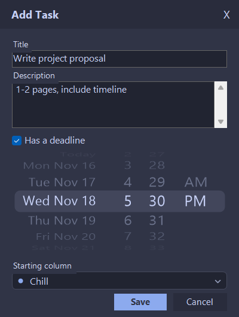
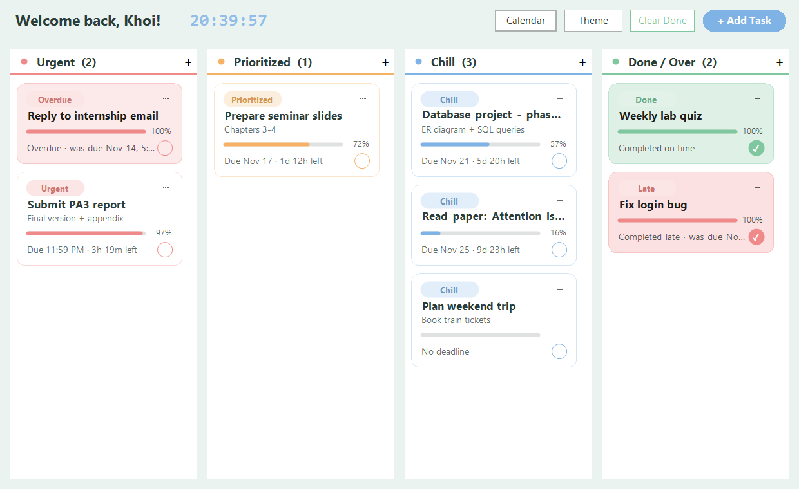

# Kanban Dashboard

A lightweight, keyboard-friendly Kanban board for Windows — built with .NET 8 WinForms and styled with the [Catppuccin Frappé](https://github.com/catppuccin/catppuccin) dark theme.


---

## Features

- **Four columns** — Urgent, Prioritized, Chill, Done
- **Automatic deadline escalation** — tasks move columns as their deadline approaches (72 h → Prioritized, 24 h → Urgent, overdue → stays Urgent with red tint)
- **Catppuccin Frappé dark theme** — out of the box, with a full theme editor to customise every color
- **Soft Daybreak light theme** — included as an alternative preset
- **Digital clock** in the header — updates every second
- **Headerless / borderless window** — drag the top bar to move, drag any edge to resize
- **Custom scrollbar** — thin, rounded, themed — no ugly OS scrollbar
- **Keyboard shortcuts**
  - `Ctrl + T` — Add a new task
  - `Esc` — Exit the app (saves automatically)
- **Clear Done** button — removes all completed tasks in one click
- **Persistent storage** — board data saved as JSON in your AppData folder

---

## Screenshots

**Board**: tasks move toward Urgent automatically as their deadlines approach.



**Calendar**: every deadline of the month at a glance. Switch with the **Calendar** / **Board** button.



| Add / edit a task | Soft Daybreak light theme |
|---|---|
|  |  |

---

## Getting Started

### Option A — Download the exe (no install needed)

1. Go to the [**Releases**](../../releases) page.
2. Download `KanbanDashboard.exe` from the latest release.
3. Double-click and run — no .NET installation required.

> The exe is self-contained (~60 MB) and portable. Your board data is saved to  
> `%AppData%\KanbanDashboard\board.json`.

---

### Option B — Build from source

#### Prerequisites

| Tool | Version | Download |
|------|---------|----------|
| .NET SDK | 8.0 or later | https://dotnet.microsoft.com/download |
| Git | any | https://git-scm.com |

> The app targets **Windows only** (WinForms).

#### 1. Clone the repository

```bash
git clone https://github.com/YOUR_USERNAME/KanbanDashboard.git
cd KanbanDashboard
```

#### 2. Run in development mode

```bash
dotnet run --project src/KanbanDashboard.csproj
```

#### 3. Build a Release binary

```bash
dotnet build src/KanbanDashboard.csproj -c Release
```

The output is at `src/bin/Release/net8.0-windows/KanbanDashboard.exe`.  
This requires .NET 8 to be installed on the target machine.

#### 4. Publish a self-contained single-file exe

```bash
dotnet publish src/KanbanDashboard.csproj -c Release -r win-x64 ^
  --self-contained true ^
  -p:PublishSingleFile=true ^
  -p:EnableCompressionInSingleFile=true ^
  -o publish
```

The standalone exe will be at `publish/KanbanDashboard.exe` (~60 MB, no .NET needed).

#### 5. Publish a faster-starting multi-file build *(optional)*

The single-file bundle above must extract itself into a temp folder on first launch, which adds ~1-2 s of startup time. If that matters to you, publish without bundling:

```bash
dotnet publish src/KanbanDashboard.csproj -c Release -r win-x64 ^
  --self-contained true ^
  -p:PublishSingleFile=false ^
  -o publish-fast
```

This produces a `publish-fast/` folder containing `KanbanDashboard.exe` and its supporting DLLs.
Keep the whole folder together — the exe will not run if the DLLs are missing.
Still no .NET installation required on the target machine.

| | Single-file (`publish/`) | Multi-file (`publish-fast/`) |
|---|---|---|
| Distribution | One `.exe` file | Whole folder |
| First-launch speed | ~1-2 s extraction delay | Instant |
| Size on disk | ~60 MB (compressed) | ~150 MB |


---

## Usage

| Action | How |
|--------|-----|
| Add a task | `Ctrl + T` or click **+ Add Task** |
| Edit a task | Double-click a card, or use the `⋯` menu |
| Mark as done | Click the circle toggle on the card's bottom-right |
| Move a task | Edit it and change the "Starting column" |
| Quick-add to a column | Click the `+` in the column header |
| Clear the Done column | Click **Clear Done** in the top bar |
| Change the theme | Click **Theme…** in the top bar |
| Move the window | Click and drag the top bar |
| Exit | Press `Esc` |

---

## Project Structure

```
KanbanDashboard/
├── src/
│   ├── Models/          # Data models (TaskItem, AppTheme, BoardColumn…)
│   ├── Services/        # DataStore (JSON), DeadlineService, ColorHelper
│   ├── UI/              # WinForms controls and dialogs
│   │   ├── MainForm.cs          # App shell, keyboard shortcuts, timers
│   │   ├── MainForm.Layout.cs   # Control layout (partial class)
│   │   ├── ColumnPanel.cs       # Board column with custom scrollbar
│   │   ├── TaskCardControl.cs   # Individual task card
│   │   ├── TaskEditDialog.cs    # Add / Edit task dialog
│   │   └── ThemeDialog.cs       # Theme editor dialog
│   └── Program.cs
├── LICENSE
└── README.md
```

---

## Theme Customisation

Click **Theme…** to open the theme editor. You can change any of the 10 colors:

| Setting | What it controls |
|---------|-----------------|
| App background | Main window background |
| Panel / header | Top bar, column headers |
| Card background | Task card fill |
| Text color | All text |
| Urgent column | Red accent |
| Prioritized column | Peach/orange accent |
| Chill column | Blue accent |
| Done column | Green accent |
| Done – on time | Card tint for on-time completions |
| Done – past deadline | Card tint for late completions |

Two presets are built in: **Frappe (dark)** and **Daybreak (light)**.

---

## License

This project is released under the [MIT License](LICENSE).  
Feel free to use, fork, and modify it for any purpose.

---

## Acknowledgements

- [Catppuccin](https://github.com/catppuccin/catppuccin) — for the beautiful Frappé palette
- [.NET 8 WinForms](https://learn.microsoft.com/en-us/dotnet/desktop/winforms/) — UI framework
